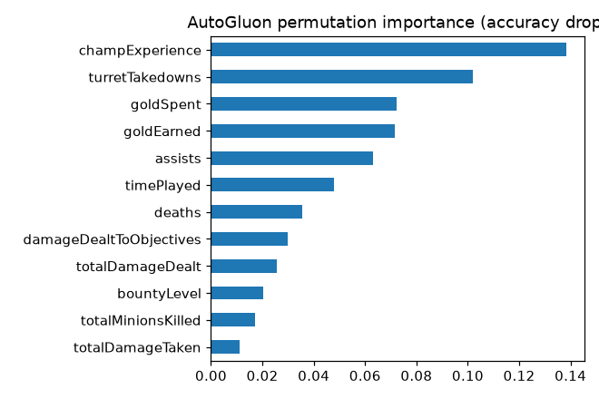

# AutoML with AutoGluon

## Introduction

AutoGluon is an open-source AutoML library for tabular data. You give it a table and a label. It trains several families of models (LightGBM, CatBoost, XGBoost, random forests, extra trees and small neural networks), then combines the best ones into a weighted ensemble. In this lab you give it the same post-game data and the same split by match as in Lab 4, and you check whether AutoML beats a scikit-learn model that trained in eight seconds.

Two details that the first version of this workshop got wrong are fixed here. First, AutoGluon's `time_limit` is the **total** training budget for all models, not a limit per model. Second, AutoGluon needs a validation set, and by default it draws it at random from the training rows, so players of the same match end up on both sides. You pass your own validation set, split by match.

Estimated Time: 25 minutes (about 10 minutes of that is training)

### Objectives

In this lab, you will:

* Train a `TabularPredictor` with an explicit validation set that is split by match
* Read the leaderboard and understand what `time_limit` means
* Compare AutoGluon with the scikit-learn baseline on the same test matches
* Explain the model with permutation importance
* Record the AutoGluon version next to the model and make a small deployment copy

### Prerequisites

This lab assumes you have:

* Completed Labs 1, 2 and 4

## Task 1: Train on matches the model has not seen

1. In JupyterLab, open `notebooks/02_autogluon.ipynb` and run the first cells. They print the library versions and create **three** groups of matches: training, validation and test.

    ```text
    autogluon 1.6.3 | scikit-learn 1.9.1
    train       145,210 rows  14,521 matches
    validation   36,310 rows   3,631 matches
    test         45,390 rows   4,539 matches
    ```

2. Run the cell that calls `TabularPredictor(...).fit(...)`. It uses `presets="medium_quality"`, `time_limit=240` seconds and `tuning_data` set to the validation matches. Training takes four minutes. The log tells you what AutoGluon decides:

    ```text
    Beginning AutoGluon training ... Time limit = 240s
    Fitting 11 L1 models, fit_strategy="sequential" ...
    Fitting model: LightGBMXT ... Training model for up to 239.50s of the 239.50s of remaining time.
    ...
    AutoGluon training complete, total runtime = 238.3s ... Best model: WeightedEnsemble_L2
    ```

    Eleven models were planned, but the budget ended after six. CatBoost alone took 159 seconds, so the neural networks and XGBoost never ran. That is the meaning of `time_limit`: AutoGluon spends the budget on the models in its priority order and stops. A larger budget or the `best_quality` preset would train more of them.

## Task 2: Read the leaderboard

1. Run the leaderboard cell. It scores every model on the test matches.

    ```text
                     model  score_test  score_val  fit_time  pred_time_test
    0  WeightedEnsemble_L2      0.9222     0.9266  171.6506          0.6397
    1             CatBoost      0.9221     0.9265  159.3796          0.1007
    2           LightGBMXT      0.9215     0.9252   16.7860          0.7831
    3             LightGBM      0.9197     0.9246   12.1832          0.5261
    4     RandomForestEntr      0.9013     0.9039   20.5172          0.3969
    5     RandomForestGini      0.9003     0.9037   23.0759          0.4951
    6       ExtraTreesGini      0.8927     0.8961    2.6085          0.1576
    ```

    `score_val` is measured on the validation matches that guided the training, and `score_test` on matches nobody used for any decision. The two agree within half a point, which is what you expect from a split that respects matches. The ensemble is 90.9 % CatBoost and 9.1 % LightGBM.

## Task 3: Compare with scikit-learn

1. Run the comparison cell. It trains the scikit-learn `HistGradientBoostingClassifier` from Lab 4 on the training and validation matches together and scores both models on the same test matches.

    ```text
                                       accuracy     AUC  training seconds
    scikit-learn HistGradientBoosting    0.9191  0.9765            8.2277
    AutoGluon (240s budget)              0.9222  0.9780          240.0000
    ```

2. Think about what you see. AutoGluon wins by 0.3 accuracy points and 0.0015 AUC, and it needed 30 times longer. AutoML did not discover a better kind of model. It found an ensemble that is slightly better than the single model a data scientist would have chosen. Its real value is that **you did not have to choose**: no model selection, no tuning and a leaderboard to inspect. If the baseline is within a point of AutoML, the time is better spent on the data: features, labels and, above all, leakage (Lab 7).

## Task 4: Explain the model

1. Run the `feature_importance` cell. AutoGluon shuffles each column on 3,000 test rows, three times, and measures the drop in accuracy.

    ```text
                             importance  stddev  p_value
    champExperience              0.1383  0.0029   0.0001
    turretTakedowns              0.1021  0.0008   0.0000
    goldSpent                    0.0724  0.0018   0.0001
    goldEarned                   0.0716  0.0052   0.0009
    assists                      0.0631  0.0018   0.0001
    timePlayed                   0.0479  0.0030   0.0006
    ```

    

    The ranking agrees with the scikit-learn model in Lab 4: experience, turret takedowns, gold and assists. Different libraries, same story.

## Task 5: AutoGluon on the by-minute data

1. Run the next cells. They train a second predictor on the 10 live-safe by-minute stats, again with a validation set split by match.

    ```text
                                       accuracy
    scikit-learn HistGradientBoosting    0.5921
    AutoGluon (240s)                     0.5951
    ```

    The two differ by 0.3 points. The hard part of this problem is not the algorithm. Ten stats of one player simply do not say much about who wins.

## Task 6: Keep the model portable

1. Run the last cell. It prints the model names, the AutoGluon version and the size of the model folder.

    ```text
    best model    : WeightedEnsemble_L2
    trained with  : AutoGluon 1.6.3
    folder size   : 1352 MB
    deploy clone  : 13 MB
    ```

2. Notice two practical facts.

    * **Version coupling.** An AutoGluon predictor can only be loaded by the same AutoGluon version that trained it. Loading it with another version raises an error, and forcing it can crash. The notebook reads `version.txt` from the model folder, and the pinned `requirements.txt` guarantees the same version everywhere in this workshop. When you hand a model to someone else, hand over the version too, or deploy it behind an HTTP endpoint (Lab 8).
    * **Size.** The training folder holds every model and is 1,352 MB. `clone_for_deployment` keeps only what the best model needs to predict: 13 MB.

## Learn More

* [AutoGluon Tabular documentation](https://auto.gluon.ai/stable/tutorials/tabular/index.html)
* [AutoGluon: how `time_limit` and presets work](https://auto.gluon.ai/stable/tutorials/tabular/tabular-essentials.html)

## Acknowledgements

* **Author** - Ignacio Martinez, Oracle
* **Last Updated By/Date** - Ignacio Martinez, October 2026
