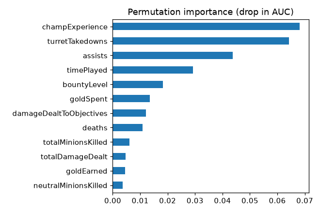
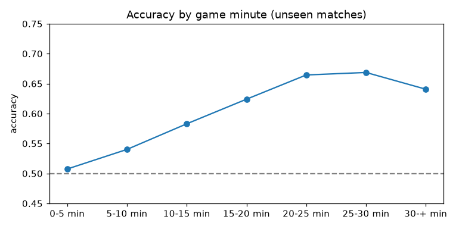
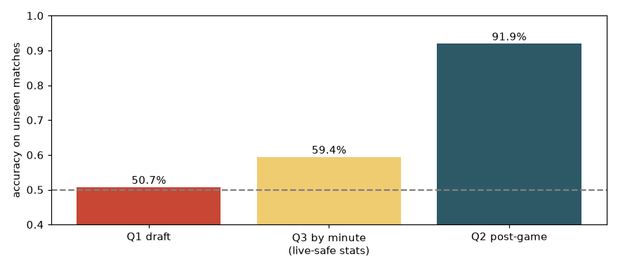

# Baselines with scikit-learn

## Introduction

Before you reach for AutoML or a neural network, build the simplest model that could work and see how far it goes. A **baseline** tells you what a good score looks like on your data and gives every fancier model something to beat.

In this lab you open notebook `01_explore_and_baseline.ipynb` and answer the three questions of the workshop with scikit-learn: can you predict the winner from the **draft**, from **final post-game stats**, and **by minute** during the game? You use logistic regression and gradient boosting, split the data by match, and read the results.

Estimated Time: 20 minutes

### Objectives

In this lab, you will:

* Split data by match so that no game appears on both sides of the split
* Build a logistic regression and a gradient boosting classifier with scikit-learn
* Measure accuracy and AUC, and compare them with the 50 % coin flip
* Explain a model with permutation importance
* Draw the accuracy of a live predictor as a function of the game minute

### Prerequisites

This lab assumes you have:

* Completed Labs 1 and 2, with the data downloaded

## Task 1: Open the notebook

1. In your terminal, start JupyterLab from the `lol-ml-26ai` folder with the environment active.

    ```bash
    <copy>
    python -m jupyterlab notebooks
    </copy>
    ```

    In an OCI Data Science notebook session you already are in JupyterLab: open the `lol-ml-26ai/notebooks` folder in the file browser.

2. Open `01_explore_and_baseline.ipynb`. If JupyterLab asks for a kernel, choose **Python 3** (laptop) or **lolml (Python 3.12)** (OCI notebook session).

3. Run all cells: **Run**, **Run All Cells**. On an 11-core laptop the whole notebook takes about a minute. Without a download, it runs on the small sample that ships with the repository and prints `[small committed sample]` after the file name.

## Task 2: Split by match and build the draft model

1. Read the output of the cell that calls `group_split`. With the full data it reads:

    ```text
    train 181,520 rows / 18,152 matches   test 45,390 rows / 4,539 matches
    ```

    80 % of the matches train the model and 20 % test it. The `assert` in that cell proves that no match is on both sides.

2. Read the draft model result.

    ```text
    Q1 draft only (logistic regression)        accuracy 0.507   AUC 0.512
    ```

    The draft model knows the champion, the lane, the side of the map and the two summoner spells. It scores 50.7 % accuracy and an AUC of 0.512. The **AUC** (area under the ROC curve) is 0.5 for a model that ranks winners and losers no better than chance and 1.0 for a perfect one. The draft model is a coin flip. Picking a champion does not decide a ranked game, and nothing else is known at that point.

## Task 3: Predict from post-game stats

1. Read the post-game results. The notebook trains two models on 68 post-game features (kills, deaths, gold, damage, vision and so on) without the columns that state how the game ended.

    ```text
    Q2 post-game (logistic regression)         accuracy 0.901   AUC 0.961
    Q2 post-game (HistGradientBoosting)        accuracy 0.919   AUC 0.977
    ```

    A logistic regression, which fits one weight per feature, already reaches 90.1 %. Gradient boosting (many small decision trees, each correcting the previous ones) adds 1.8 points. The jump from 50.7 % to 91.9 % has a simple reason: final stats are the *consequence* of winning. A team that won has destroyed turrets and earned more gold. This is a **post-game explainer**, not a predictor.

2. Look at the permutation importance chart. The notebook shuffles one column at a time on the test set and measures how much the AUC drops.

    

    Experience (`champExperience`), `turretTakedowns`, assists and `timePlayed` lead. The model leans on columns that describe the **team's** outcome (turret takedowns) as much as on the player's own play. Lab 7 shows how far that goes.

## Task 4: Predict by minute

1. Read the two by-minute results.

    ```text
    Q3 by minute (all 18 stats)                accuracy 0.601   AUC 0.655
    Q3 by minute (live-safe stats only)        accuracy 0.594   AUC 0.645
    ```

    The by-minute model sees 18 stats of one player at one moment. The second line uses only the 10 stats that the Live Client API reports in the same units as the training data (Lab 8 explains why). Dropping the other 8 costs 0.8 points.

2. Look at the accuracy by game minute, computed on the 700 test matches.

    

    ```text
                0-5 min  5-10 min  10-15 min  15-20 min  20-25 min  25-30 min   30-+ min
    accuracy      0.507     0.540      0.583      0.624      0.665      0.669      0.641
    ```

    In the first five minutes the model is guessing (50.7 %). It improves as the game reveals who is ahead and reaches about 67 % around minute 25. It never gets close to the 92 % of the post-game model, because it sees one player's 10 stats, not the gold, kills and objectives. These numbers are the honest answer to "can AI win League of Legends?": **a bit better than a coin flip while the game is on, and unable to help in champion select**.

## Task 5: Read the scoreboard

1. The last cells print a table and draw a bar chart. They also save the scores to `outputs/baseline_results.json`.

    

2. Try one change and run the notebook again. For example set `test_size=0.5` in `group_split`, add `max_depth=3` to the gradient boosting model, or move one of the outcome columns back into the feature list. Note which scores move and by how much.

## Learn More

* [scikit-learn: HistGradientBoostingClassifier](https://scikit-learn.org/stable/modules/generated/sklearn.ensemble.HistGradientBoostingClassifier.html)
* [scikit-learn: Permutation feature importance](https://scikit-learn.org/stable/modules/permutation_importance.html)
* [scikit-learn: GroupShuffleSplit](https://scikit-learn.org/stable/modules/generated/sklearn.model_selection.GroupShuffleSplit.html)

## Acknowledgements

* **Author** - Ignacio Martinez, Oracle
* **Last Updated By/Date** - Ignacio Martinez, October 2026
