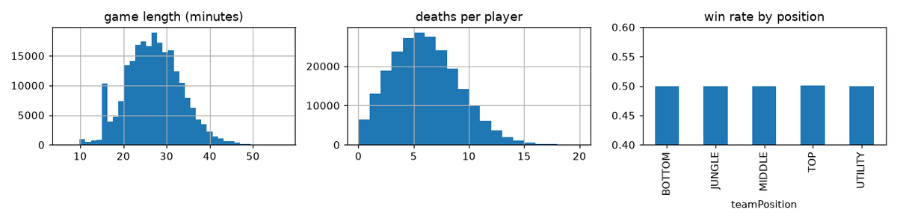

# Meet the Data

## Introduction

In this lab you download the two datasets, check that they are the files the workshop was tested with, and look at what is in them. You also learn the one structural fact that decides how you must evaluate every model in this workshop: **ten rows belong to the same match**.

The datasets are public files on Kaggle. The download script reads them anonymously (no Kaggle account, no API key), verifies them with a checksum and writes two compact files to your computer. If you prefer not to download anything, the repository ships a small sample of both datasets and every notebook falls back to it automatically.

Estimated Time: 15 minutes

### Objectives

In this lab, you will:

* Download and verify the post-game and by-minute datasets
* Inspect their size, columns and structure
* Understand why rows from one match must stay together

### Prerequisites

This lab assumes you have:

* Completed Lab 1, with the environment active and your terminal in the `lol-ml-26ai` folder

## Task 1: Download the datasets

1. Run the download script. It streams the two source files from Kaggle without downloading the whole archives (the post-game file is about 440 MB compressed, the by-minute file 23 MB), keeps every sixth match of the post-game data, removes columns that identify players, and writes Parquet files to `data/`.

    ```bash
    <copy>
    python scripts/fetch_data.py
    </copy>
    ```

2. Wait two to four minutes. The output ends like this. The two long hexadecimal strings are the SHA-256 checksums of the source files.

    ```text
    [performance] source sha256 04b1cbc2138e147f99c6ea648b7976fd8e4e28bb6503d54dd948a6e699c0fd3b  (1,105,668,735 bytes, CRC-32 checked by zipfile)
    [performance] wrote .../data/performance.parquet (226,910 rows, 98 columns)
    [by_minute] source sha256 a036228a2266156b98eaab1dfaa72674356ab8945f750c11b10a4b387a06e4db  (91,183,868 bytes, CRC-32 checked by zipfile)
    [by_minute] wrote .../data/by_minute.parquet (1,000,000 rows, 26 columns)
    ```

    The script stops with `CHECKSUM MISMATCH` if the public file ever changes, so you always know which data your numbers came from. The expected checksums, row counts and column counts are stored in `data/checksums.json`.

> **Note:** The files are hosted on Kaggle because the author of the original workshop published them there and they are still downloadable without a login. The download lives in one script, `scripts/fetch_data.py`, so the source can change without touching the labs.

## Task 2: Look at the data

1. Print a summary of both datasets.

    ```bash
    <copy>
    python scripts/peek_data.py
    </copy>
    ```

2. Read the output. It should match the following lines.

    ```text
    post-game: 226,910 rows, 22,691 matches, 98 columns, rows per match: [10], share of wins: 0.50
    163 champions, game length median 26.9 min (min 6.1, max 57.2)
         match_id championName teamPosition  kills  deaths  assists  goldEarned  duration  win
    0  2317437376       Irelia          TOP   15.0    11.0      9.0     20032.0     37.55  1.0
    1  2317437376         Fizz       MIDDLE    5.0      3.0      4.0     15431.0     37.55  1.0
    ...
    by minute: 1,000,000 rows, 3,499 matches, 26 columns, 28.6 snapshots per player per match
             match_id  slot   minute  maxhealth  attackdamage  armor  winner
    0  BR1_2284630300     7  3.00055        714            65     42       0
    ```

3. Compare what you see with these facts.

    * **Post-game data.** Each row is one player in one finished match. There are 10 rows per match and exactly five winners, so the share of wins is 50 % by construction. A model that always answers "win" is right half the time, and that is the number to beat.
    * **By-minute data.** Each row is one snapshot of one player: the `slot` (1 to 5 for the blue side, 6 to 10 for the red side), the `minute` of the game and 18 stats such as `maxhealth`, `attackdamage` and `armor`. The column `winner` says whether that player's team went on to win. It is the **future** outcome, which is exactly what a live predictor must guess.
    * Player names and identifiers are not in the files. The post-game file keeps a numeric `match_id`.

## Task 3: Why the match is the unit that matters

The 10 players of a match share one game. They share the length, the patch, the objectives and, of course, the result. If a model trains on some of a match's players and is tested on the others, it is partly tested on a game it has already seen.



The by-minute data makes this worse: one player contributes about 29 snapshots to the same match, one per minute, and consecutive snapshots look alike.

From now on, every split in the workshop is made **by match**: all rows of a match go to training, or all go to testing. The helper is `group_split` in `lolml/features.py`; Lab 7 measures how much a random row split would flatter the scores.

## Task 4: Preview the replay of a recorded match

For Lab 8 you will "play" a match through the same interface the League client offers. Nobody needs to start the game: a replayer sends one of the recorded matches from the by-minute data as a Live Client payload. Look at it once now.

1. Print the stats of one recorded player over time.

    ```bash
    <copy>
    python -c "from lolml import data, liveclient; mid, m = liveclient.recorded_match(data.load('by_minute')); print(mid, len(m), 'snapshots'); print(m[['minute','maxhealth','attackdamage','armor','winner']].iloc[::6].to_string(index=False))"
    </copy>
    ```

    You see match `BR1_2284630300`, player 1, with 35 snapshots from minute 0 to minute 33.4. Health and attack damage grow as the player levels up and buys items, and `winner` is 1 for the whole game: this player's team won.

## Learn More

* [Riot Games Live Client Data API](https://developer.riotgames.com/docs/lol#game-client-api)
* [Kaggle: League of Legends Optimizer dataset](https://www.kaggle.com/datasets/jasperan/league-of-legends-optimizer-dataset)
* [Kaggle: League of Legends 1v1 matchups results](https://www.kaggle.com/datasets/jasperan/league-of-legends-1v1-matchups-results)

## Acknowledgements

* **Author** - Ignacio Martinez, Oracle
* **Last Updated By/Date** - Ignacio Martinez, October 2026
