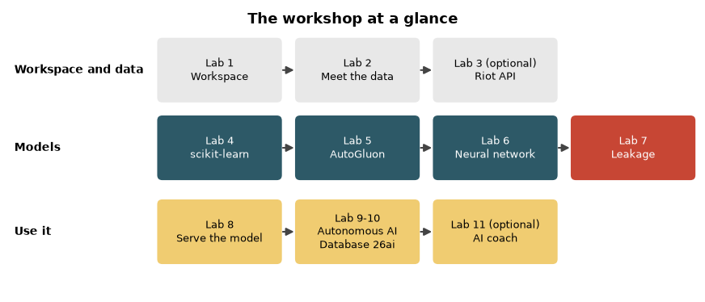

# Introduction

## About this Workshop

Can a model predict who wins a League of Legends match? The answer depends on **when** you ask. In this workshop you build models for three different moments, measure each one honestly on matches the model has never seen, and learn why the numbers you see in many tutorials, including the first version of this workshop, are too good to be true.

| Question | What the model knows | Accuracy on unseen matches |
| --- | --- | --- |
| 1. Draft | champion, lane, side, summoner spells | 50.7 % (a coin flip is 50 %) |
| 2. Post-game | one player's final stats, without the columns that spell out the result | 91.9 % |
| 3. By minute | 10 in-game stats of one player, at any point of the game | 59.4 % overall, from 50.7 % in minutes 0 to 5 to about 67 % around minute 25 |

Those numbers come from the models you build in Labs 4 to 6, trained on 22,691 ranked matches (post-game) and 3,499 matches (by minute). Lab 7 then shows how the same data produces **99 %** accuracy if you let the model see the destroyed nexus, and why that number means nothing.

> **Note:** This workshop replaces three earlier League of Legends labs on Oracle LiveLabs (data extraction, model building with scikit-learn and AutoGluon, and introduction to neural networks). It keeps their best ideas, fixes what no longer worked, and adds Oracle AI Database 26ai.

### What you build

1. **Workspace and data (Labs 1 to 3).** A Python 3.12 environment on your laptop or in an OCI Data Science notebook session, the two public datasets, and an optional extraction of your own matches with Riot's current API. The core path needs **no Riot account and no API key**.
2. **Models (Labs 4 to 7).** A scikit-learn baseline, AutoML with AutoGluon, a neural network written by hand in PyTorch and then with fastai, and the leakage lesson.
3. **Use it (Labs 8 to 11).** Serve the model locally and learn how OCI Data Science Model Deployment would host it, load the data into Autonomous AI Database 26ai and query it with SQL, Select AI, AI Vector Search and an ONNX model scored inside the database, and finish with an optional OCI Generative AI coach.

### Where the data comes from

Two public datasets, downloaded anonymously from Kaggle by a script that verifies their checksums:

* **Post-game rows:** one row per player per finished ranked match, about 100 columns of final stats. The workshop keeps every sixth match: 226,910 rows from 22,691 complete matches. Player names and identifiers are removed.
* **By-minute rows:** 1,000,000 snapshots of 10 in-game stats (health, armor, attack damage and so on) from 3,499 matches, the same stats the League client exposes locally through the Live Client Data API.

Both were collected in earlier seasons. They describe how those patches played, not today's game balance, and you should treat the absolute numbers as a teaching result rather than a prediction service.

### What changed from the earlier labs

| Earlier labs | This workshop |
| --- | --- |
| Terraform, Ansible, a VM and an Autonomous JSON Database that the labs never used | A Python environment. The database appears in Labs 9 and 10 and is used for real. |
| Python 3.8 and unpinned requirements that no longer install | Python 3.12 and pinned, tested versions |
| A Riot API key required on day one, and scripts that depend on SummonerIDs that Riot removed in July 2025 | No key for the core path. The optional extraction uses puuid and match-v5. |
| "99.99 % R squared" and "99.32 % win accuracy" | The leakage that produced those numbers, shown and measured in Lab 7 |
| scikit-learn in the title, none in the labs | scikit-learn first, then AutoGluon, then neural networks, compared on the same split |
| A Windows-only live model script | A mock Live Client and a recorded-match replay that run on macOS, Linux and Windows |

### Riot Games policy

This workshop is an educational project and is not endorsed by Riot Games. Predicting a win probability from information that only the player sees during a game is a gray area for any product you distribute. Keep the live scoring in Lab 8 to private, local experiments and read [Riot's developer policies](https://developer.riotgames.com/policies/general) before you build anything on top of it.

Estimated Workshop Time: 4 hours 25 minutes (2 hours 30 minutes for the core path, Labs 1, 2 and 4 to 8; 1 hour 5 minutes for the database Labs 9 and 10; 35 minutes for the optional Labs 3 and 11; 15 minutes for Clean Up)

### Objectives

By the end of this workshop you will be able to:

* Set up a reproducible Python 3.12 machine learning environment locally or in OCI Data Science
* Build and compare a scikit-learn baseline, an AutoGluon model and a neural network on the same data
* Split data by match and explain why a random row split overstates accuracy
* Recognize target leakage and measure how much it inflates a score
* Serve a model behind a small HTTP service, and read live game data from the Live Client API or from a replayed match
* Load the data into Autonomous AI Database 26ai and use SQL, Select AI, AI Vector Search and an ONNX model inside the database
* Turn model output and percentiles into a post-game coaching tip with OCI Generative AI

### Prerequisites

* A laptop or workstation with macOS, Linux or Windows (WSL2 recommended), 16 GB of memory and 10 GB of free disk space
* Basic Python and pandas
* For Labs 9 to 11 only: an Oracle Cloud account (a free trial is enough for the database), or Docker to run Oracle AI Database Free locally
* You do **not** need a League of Legends account, a Riot API key or a Kaggle account

## Learn More

* [Oracle AI Database 26ai](https://www.oracle.com/database/)
* [OCI Data Science](https://docs.oracle.com/en-us/iaas/data-science/using/data-science.htm)
* [AutoGluon](https://auto.gluon.ai/stable/index.html)
* [fastai tabular](https://docs.fast.ai/tabular.core.html)
* [Riot Games developer portal](https://developer.riotgames.com/)

## Acknowledgements

* **Author** - Ignacio Martinez, Developer Advocate, Oracle
* **Last Updated By/Date** - Ignacio Martinez, October 2026
