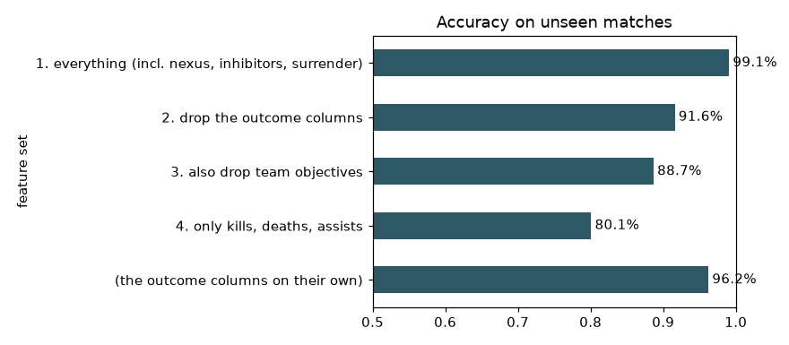

# Leakage and Honest Evaluation

## Introduction

The first version of this workshop reported an R squared of 99.99 % for a "player performance" model and 99.32 % accuracy for a win model. Neither number measured prediction. In this lab you reproduce that kind of result on purpose, find out where it comes from, and learn four habits that keep it out of your own work.

**Target leakage** means a model sees information it would not have when the prediction matters, or a rewording of the answer. The model looks superb in the notebook and fails in real life. Leakage is the most common reason a model's published accuracy is higher than what you get in production.

Estimated Time: 20 minutes

### Objectives

In this lab, you will:

* Measure how much each group of columns inflates the accuracy of a win model
* Show that a "performance score" target is a formula of its own inputs
* Compare a split by rows with a split by match
* Use a checklist to review any model score before you trust it

### Prerequisites

This lab assumes you have:

* Completed Labs 1, 2 and 4

## Task 1: The leakage ladder

1. Open `notebooks/04_leakage_and_splits.ipynb` and run the cells up to the first chart. The notebook trains the same gradient boosting model, on the same split by match, with four sets of columns. Each set removes something a real predictor would not have.

    ```text
                                                        features  accuracy
    feature set
    1. everything (incl. nexus, inhibitors, surrender)        78    0.9909
    2. drop the outcome columns                               68    0.9161
    3. also drop team objectives                              57    0.8868
    4. only kills, deaths, assists                             3    0.8010
    (the outcome columns on their own)                        10    0.9624
    ```

    

2. Read the ladder from top to bottom.

    * **Rung 1: 99.1 %.** This is the "99 %" of the original workshop. The set includes `nexusKills`, `nexusTakedowns`, `nexusLost`, `inhibitorKills`, `inhibitorsLost` and the surrender flags. Look at the last line: those **ten columns alone** give 96.2 %. They only exist because the game ended, so the model reads the result instead of predicting it.
    * **Rung 2: 91.6 %.** Without the ten outcome columns the score is still very high. Columns such as `turretKills`, `damageDealtToBuildings` and `dragonKills` describe what the *team* achieved, and a team that wins takes more objectives.
    * **Rung 3: 88.7 %.** Without the team objectives, the model uses what a single player did: gold, damage, minions, vision and so on.
    * **Rung 4: 80.1 %.** Three numbers, kills, deaths and assists, already classify four games out of five.

    Even rung 4 is a **post-game** score. Nothing on this ladder can be used to predict a game that has not been played, and the model in Lab 4 that sees only the draft stays at 50.7 %.

## Task 2: A target that is a formula

1. Run the next cells. The original workshop trained a regression model on `calculated_player_performance`, a score that the extraction script computed from the other columns:

    `100 * (0.336 - 1.437 * deaths/min + 0.000117 * gold/min + 0.443 * (kills+assists)/min + 0.264 * level/min + 0.000013 * damage/min)`

    Ordinary linear regression on those five per-minute stats finds it:

    ```text
    R^2 of plain linear regression: 0.9889
    {'deaths_pm': -1.420773, 'gold_pm': 0.000115, 'ka_pm': 0.438219, 'level_pm': 0.260762, 'damage_pm': 1.3e-05} intercept 0.336
    ```

    The fitted weights are the constants of the formula. The R squared is 0.989 instead of exactly 1 because the dataset measures game length slightly differently from the original script; for 99 % of the rows the formula is reproduced to within two points. The old claim "99.99 % R squared" was a model rediscovering a formula that somebody had typed in. Nothing was predicted. If a target is computed from your features, either drop the target or drop the features it uses.

## Task 3: Random rows versus whole matches

1. Run the split comparison. The by-minute data has about 29 snapshots per player and 286 per match. With a **row split** the test set contains snapshots of matches the model has trained on. With a **match split** it does not.

    ```text
                               gradient boosting  1-nearest-neighbour
    split
    row split (shuffled rows)             0.5958               0.5844
    match split                           0.5920               0.5308
    ```

2. Compare the two columns.

    * **Gradient boosting** is only slightly optimistic with a row split: 59.6 % against 59.2 %. It generalizes, and it cannot memorize.
    * **1-nearest-neighbour** barely learns anything: it finds the closest row it has seen and copies its label. With a row split the closest row is often the same player a minute earlier, and the model scores 58.4 %. On unseen matches it falls to 53.1 %, close to a coin flip. A 5.4 point gap is a model that memorized.

    A flexible model, a small dataset and strong dependence between rows make the gap larger. Always split by the thing that defines "a new game".

## Task 4: A checklist before you believe a number

Use these five questions on every score you see, including the ones in this workshop.

1. Will I have this column **at the moment I need the prediction**?
2. Is a feature computed from the target, or from something that is?
3. Do rows from the same match, player or session appear on both sides of the split?
4. Is the score too good? Compare with a trivial baseline (always predicting "win" gives 50 %).
5. What happens to the score if I remove the single most important feature?

Now go back to the table in the introduction and apply them. The 91.9 % post-game score passes question 3 and fails question 1 for any use during a game. That is why Lab 8 serves the **by-minute** model, which is modest and honest.

## Learn More

* [scikit-learn: Common pitfalls, data leakage](https://scikit-learn.org/stable/common_pitfalls.html#data-leakage)
* [scikit-learn: Cross-validation iterators for grouped data](https://scikit-learn.org/stable/modules/cross_validation.html#cross-validation-iterators-for-grouped-data)

## Acknowledgements

* **Author** - Ignacio Martinez, Oracle
* **Last Updated By/Date** - Ignacio Martinez, October 2026
