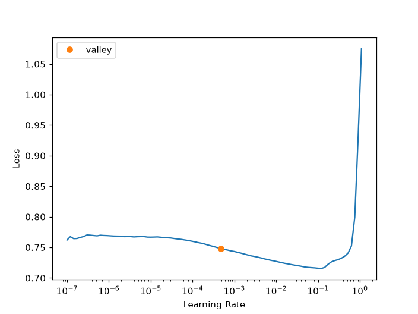
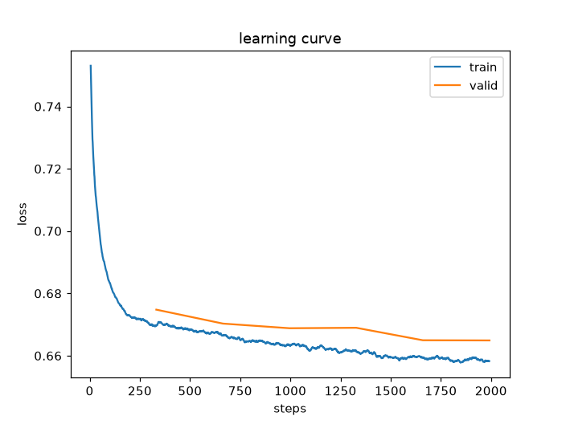
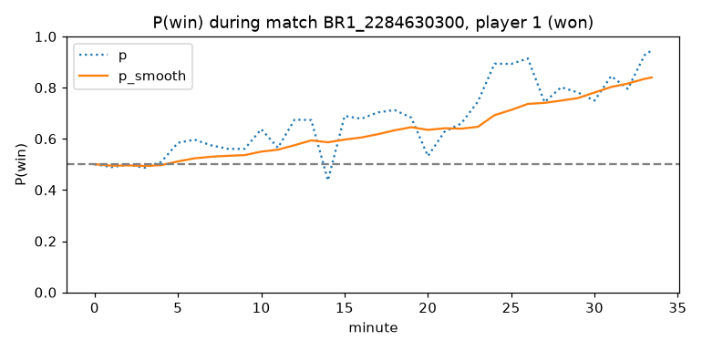
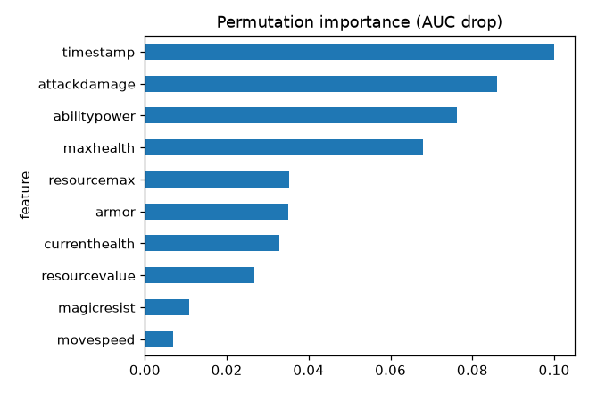

# Neural Networks with PyTorch and fastai

## Introduction

A neural network for a table of numbers is simpler than its reputation. It is a stack of layers. Each layer multiplies its input by a matrix of weights, adds a bias and applies a simple non-linear function. The last layer outputs the probability of a win. **Training** adjusts the weights so that the predicted probabilities get closer to what actually happened.

In this lab you write that training loop yourself in about fifteen lines of PyTorch so that nothing is hidden. Then you do the same with fastai, which adds normalization, a learning-rate finder and a learning-rate schedule. You evaluate on matches the network has never seen, draw a win-probability curve for one match, fix two bugs of the original notebook (the wrong class label and a crashing importance plot), and train a second network that learns an embedding for every champion.

Estimated Time: 25 minutes

### Objectives

In this lab, you will:

* Explain forward pass, loss, backward pass, optimizer step, batch, epoch and learning rate
* Train a network by hand in PyTorch and with fastai
* Read class probabilities in the right order
* Draw a win probability curve and smooth it with a sliding window
* Measure permutation importance for any model with a predict function
* Compare a neural network honestly with gradient boosting

### Prerequisites

This lab assumes you have:

* Completed Labs 1, 2 and 4

## Task 1: The vocabulary

Read this once. The numbers refer to the lines of the training loop you are about to run.

* The **forward pass** (line 1) pushes a batch of rows through the layers and produces one probability per row.
* The **loss** (line 2) measures how wrong those probabilities are. For a win/loss question it is the cross-entropy: confident wrong answers are punished hard.
* The **backward pass** (line 3) computes the gradient of the loss with respect to every weight: which way, and how strongly, should each weight move to reduce the loss.
* The **optimizer step** (line 4) moves every weight a little in that direction. The size of the step is the **learning rate**. Too small and nothing happens, too large and the loss explodes.
* A **batch** is the group of rows used for one step. An **epoch** is one pass over the whole training set. It is not a "cycle" of a recurrent network, as the first version of this workshop said.

## Task 2: Write the loop by hand

1. Open `notebooks/03_neural_network.ipynb` and run the cells up to the heading **The training loop, written by hand**. The notebook splits the by-minute data by match and standardizes each of the 10 live-safe stats with the mean and standard deviation of the training rows.

    ```text
    {'train': '680,541 rows / 2,379 matches', 'valid': '118,693 rows / 420 matches', 'test': '200,766 rows / 700 matches'}
    ```

2. Run the cell with the loop. The network has two hidden layers (200 and 100 units). Six epochs take a few seconds.

    ```text
    epoch 1: train loss 0.6669  valid loss 0.6727  valid accuracy 0.5686
    epoch 2: train loss 0.6799  valid loss 0.6700  valid accuracy 0.5724
    ...
    epoch 6: train loss 0.6551  valid loss 0.6664  valid accuracy 0.5768
    hand-written PyTorch MLP on unseen matches: accuracy 0.5842  AUC 0.6287
    ```

    The validation loss goes down epoch by epoch and the accuracy rises slowly. The `train loss` shown is that of the **last batch** of the epoch, which is why it jumps around. The score on the 700 test matches is 58.4 %.

## Task 3: The same network with fastai

1. Run the cells that create `TabularPandas` and the learner. fastai prints the order of the classes.

    ```text
    [0, 1]
    ```

    This is the **vocabulary**: index 0 is "loss", index 1 is "win". Remember it for Task 4.

2. Run `lr_find`. It trains for a short time while increasing the learning rate and plots the loss.

    

    The orange dot is the `valley` suggestion, here about 0.0005. A learning rate where the curve is still going down, before it explodes, is a good choice. The notebook uses 0.002 with the **one-cycle** schedule, which first increases and then decreases the rate.

3. Run `fit_one_cycle` and look at the learning curve.

    

4. Read the result on the test matches.

    ```text
    fastai MLP on unseen matches: accuracy 0.5852  AUC 0.6318
    ```

    The hand-written network (58.4 %, AUC 0.629) and the fastai one (58.5 %, AUC 0.632) are the same network, trained a little differently. Both are slightly **below** the gradient boosting models of Labs 4 and 5 (59.4 % and 59.5 %). On a table of ten numbers, trees are hard to beat. A neural network earns its place when you have embeddings of categories, text or images, or many more rows.

## Task 4: Read the probabilities in the right order

1. Run the cell that prints the first test row.

    ```text
    first test row: true winner=0  P(win) = 50.4 %  (P(loss) = 49.6 %)
    ```

    The cell looks up the class by name: `list(learn.dls.vocab).index(1)` is the column of "win". The original notebook printed `probs[0]` as the winning probability. That is the probability of **losing**, and it also printed a fraction such as 0.96 with a percent sign. Always find the column through the vocabulary.

## Task 5: A win-probability curve

1. Run the next cell. It takes the 35 snapshots of player 1 in the first test match and plots P(win) at every one of them, raw and smoothed with a sliding window of 10 predictions.

    

    The dotted line is noisy: one snapshot with unusual health is enough to move it. The solid line, the mean of the last 10 predictions, is what you would show on a live overlay. This player's team won, and the smoothed curve climbs from 50 % to about 84 %, but the model had no way to know that at minute 5.

## Task 6: Permutation importance, fixed

1. Run the importance cell. The helper `lolml.importance.permutation_importance` takes **any** function that returns P(win) for a DataFrame, so it works for fastai, PyTorch, scikit-learn or an AutoGluon predictor. The original notebook failed here with `Rectangle.set() got an unexpected keyword argument 'sort_columns'` because pandas removed that argument.

    ```text
    baseline AUC on the subset: 0.6311
             feature  importance     std
    0      timestamp      0.0999  0.0003
    1   attackdamage      0.0861  0.0023
    2   abilitypower      0.0763  0.0035
    3      maxhealth      0.0680  0.0027
    4    resourcemax      0.0353  0.0017
    ```

    

2. Interpret it. The game clock (`timestamp`) matters most: the same stats mean something different at minute 5 and minute 30. Attack damage, ability power and health are proxies for how many items and levels the player has. Movement speed barely matters.

## Task 7: A network for the post-game data, with embeddings

1. Run the last section. The post-game data has categorical columns, the champion and the position, and fastai turns every category into a short vector of numbers that it learns (an **embedding**).

    ```text
    post-game fastai MLP on unseen matches: accuracy 0.9172  AUC 0.9758
    championName embedding matrix: 164 champions x 28 learned numbers each
    position embedding matrix:     6 x 4
    ```

    Each category gets one extra row for "unknown" (163 champions plus one, 5 positions plus one). The network scores 91.7 %, next to 91.9 % for gradient boosting (Lab 4). The champion embeddings are learned, but they are not very informative here, because the final stats already explain nearly everything. Do not read meaning into the distances between them. Embeddings pay off when the identity of the category carries the signal.

2. The notebook finishes by exporting the by-minute learner to `models/nn_by_minute.pkl` (357 KB) and checks that the reloaded learner gives the same predictions. Lab 8 serves a lighter gradient boosting model instead, because it loads in milliseconds and does not need PyTorch.

## Learn More

* [fastai tabular tutorial](https://docs.fast.ai/tutorial.tabular.html)
* [PyTorch: Optimizing model parameters](https://pytorch.org/tutorials/beginner/basics/optimization_tutorial.html)
* [TensorFlow Playground](https://playground.tensorflow.org/) to build intuition for layers and activations in the browser

## Acknowledgements

* **Author** - Ignacio Martinez, Oracle
* **Last Updated By/Date** - Ignacio Martinez, October 2026
