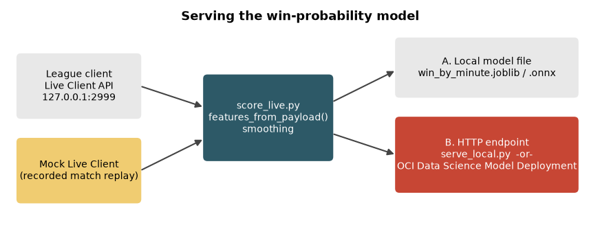

# Serve the Model

## Introduction

A model in a notebook helps nobody. In this lab you train a small, portable win-probability model, check that it survives the trip to ONNX, and feed it with game data in the format of the League of Legends **Live Client Data API**. You do not need the game: a mock server replays a recorded match through the same interface. Then you put the model behind a small HTTP service, which is exactly the contract of an OCI Data Science Model Deployment, and read how to host it there.



The earlier workshop did this with a producer and a consumer talking over WebSockets, a Windows-only script and an AutoGluon model that had to match the trainer's version. This lab keeps what is useful (live data in, probability out) and drops the rest.

Estimated Time: 25 minutes

### Objectives

In this lab, you will:

* Train and export a small LightGBM model to joblib and ONNX
* Understand why only some Live Client stats can be used as model inputs
* Score a replayed match against a mock Live Client, and optionally a real game
* Serve the model over HTTP and call it
* Describe how the same artifact runs as an OCI Data Science Model Deployment

### Prerequisites

This lab assumes you have:

* Completed Labs 1 and 2 (Labs 4 to 7 help you interpret the numbers)
* Two terminal windows, both in the `lol-ml-26ai` folder with the environment active

## Task 1: Train and export the serving model

1. Train the model. The script trains a LightGBM classifier on the by-minute data, splits by match, saves the model to `models/` as `win_by_minute.joblib` plus a JSON file with its features, and then exports an ONNX copy.

    ```bash
    <copy>
    python scripts/train_serving_model.py
    </copy>
    ```

2. Read the output. The test set is 700 matches the model has not seen.

    ```text
    trained: {'features': ['magicresist', 'timestamp', 'maxhealth', 'movespeed', 'attackdamage', 'abilitypower', 'currenthealth', 'armor', 'resourcemax', 'resourcevalue'], 'target': "P(the player's team wins)", 'scikit_learn': '1.9.1', 'train_rows': 799234, 'test_rows': 200766, 'test_matches': 700, 'test_accuracy': 0.5933, 'test_auc': 0.6451}
    ONNX written: .../models/win_by_minute.onnx (669 KB)
    joblib vs ONNX on 2000 rows: max |difference| = 1.10e-07
    ```

    The accuracy of 59.3 % is the honest by-minute number of Lab 4. The ONNX model gives the same probabilities as the joblib model to seven decimal places. You may see a warning from `onnxruntime` about an output shape: it is harmless.

    > **Note:** scikit-learn's own `HistGradientBoostingClassifier` from Lab 4 does not convert to ONNX with `skl2onnx` 1.20, which is why the serving model uses LightGBM through the same scikit-learn interface.

## Task 2: Why only ten stats

The model's inputs have to come from the Live Client API while a game runs. The API reports `activePlayer.championStats`, but not always in the units of the training data. This table compares the one recorded payload that ships with the repository (a level 1 champion) with the training data.

| Stat | Live Client sample | Training data (median, min, max) |
| --- | --- | --- |
| `maxHealth` | 675 | 1296, 340, 7534 |
| `magicResist` | 38 | 38, -10, 519 |
| `attackSpeed` | 0.679 | 125, 50, 699 |
| `healthRegenRate` | 0.75 | 23, 0, 7806 |
| `resourceRegenRate` | 1.608 | 26, 0, 1158 |
| `armorPenetrationPercent` | 1.0 | 0, 0, 61 |

Health and resistances use the same units. Attack speed is attacks per second in the live API and a percentage of the base value in the training data. Regeneration is per second against per five seconds with a different scale, and penetration is a multiplier against a percent. `lolml/liveclient.py` therefore uses the ten stats whose units agree, and the model never sees the others. Dropping the eight others cost 0.8 accuracy points in Lab 4 (59.4 % against 60.1 %). The original workshop fed the raw live values to a model trained on the other units.

> **Note:** The unit comparison uses one sample payload and the training distributions. It was not checked against a real game. If you run Lab 8 on a real game, treat the output as a demo.

## Task 3: Score a replayed match

The mock server implements the one URL the model needs, `/liveclientdata/allgamedata`, and replays a recorded match from the dataset at 30 times real speed. The match is `BR1_2284630300`, one of the 700 test matches, seen through the eyes of player 1.

1. In terminal 1, start the mock with the replay.

    ```bash
    <copy>
    python scripts/mock_liveclient.py --replay
    </copy>
    ```

    ```text
    replaying match BR1_2284630300, player slot 1 (ORDER), 35 snapshots, 33.4 game minutes, at 30x
    mock Live Client on http://127.0.0.1:2999/liveclientdata/allgamedata  (Ctrl+C to stop)
    ```

2. In terminal 2, start the scorer. It requests the game state every two seconds, converts it with `features_from_payload`, predicts, and prints the probability and a sliding mean of the last 10 predictions. The team comes from `activePlayer`, not from the first player in the list as the old script assumed.

    ```bash
    <copy>
    python scripts/score_live.py --interval 2
    </copy>
    ```

3. Watch the probability move. Press **Ctrl+C** to stop. The first lines depend on how quickly you start the scorer: the replay starts when the mock starts and lasts about 67 seconds. A run looks like this.

    ```text
    minute   2.0  team BLUE  P(win)  51.0%  smoothed(1)  51.0%
    minute   5.0  team BLUE  P(win)  57.3%  smoothed(4)  52.8%
    minute   8.0  team BLUE  P(win)  55.6%  smoothed(7)  55.6%
    minute  11.0  team BLUE  P(win)  63.2%  smoothed(10)  57.5%
    minute  13.0  team BLUE  P(win)  70.5%  smoothed(10)  61.0%
    ```

    This is the curve of Lab 6: about 50 % at the start, rising as player 1's team pulls ahead. This team won.

4. To replay again, restart the mock. To replay a different recorded match or player, add `--match-id` and `--slot` (slots 6 to 10 are the red side, and the team label switches to RED).

5. Stop the mock with **Ctrl+C** in terminal 1. Start it without `--replay` to serve the single recorded payload instead: the game clock advances but the stats do not change, so the probability stays near 48 %.

## Task 4: Use a real game (optional)

When a League of Legends game is running on your computer, the client opens the Live Client Data API on `https://127.0.0.1:2999` with a Riot self-signed certificate. It needs no API key. A practice tool game is enough.

1. Start a game, and in a terminal run the scorer against it. `--insecure` skips the certificate check for this local address only.

    ```bash
    <copy>
    python scripts/score_live.py --base-url https://127.0.0.1:2999 --insecure
    </copy>
    ```

2. The scorer prints `no game found` until the match starts. Read the policy note in the Introduction: keep this private and local.

> **Note:** This workshop never ran against the real client. The recorded payload comes from a real game against a bot, and the mock reproduces its URL and JSON shape, so the code path is the same, but the first real-game run is yours.

## Task 5: Serve the model over HTTP

An HTTP endpoint separates the code that knows about the game from the code that knows about the model. Any client can call it, and you can swap the model without touching the client.

1. In terminal 1, start the local scoring service. `--onnx` makes it use the ONNX model with `onnxruntime`.

    ```bash
    <copy>
    python scripts/serve_local.py --port 8080 --onnx
    </copy>
    ```

2. In terminal 2, check that it is healthy.

    ```bash
    <copy>
    curl -s http://127.0.0.1:8080/health
    </copy>
    ```

    ```text
    {"status": "ok", "features": ["magicresist", "timestamp", ... ], "test_accuracy": 0.5933, "test_auc": 0.6451}
    ```

3. Send a request. The body lists one object per row. The response has one probability per row.

    ```bash
    <copy>
    curl -s http://127.0.0.1:8080/predict -d '{"instances": [{"magicresist": 38, "timestamp": 600000, "maxhealth": 1900, "movespeed": 345, "attackdamage": 120, "abilitypower": 0, "currenthealth": 1500, "armor": 70, "resourcemax": 400, "resourcevalue": 300}]}'
    </copy>
    ```

    On Windows PowerShell, use `curl.exe` and put the JSON in a file (`-d "@request.json"`), because PowerShell removes the quotes.

4. Leave the service running, start the mock replay in a third terminal (`python scripts/mock_liveclient.py --replay`) and score through the endpoint.

    ```bash
    <copy>
    python scripts/score_live.py --endpoint http://127.0.0.1:8080/predict --interval 2
    </copy>
    ```

    The output is the same as in Task 3, because the same model answers. Stop all three programs with **Ctrl+C**.

## Task 6: Host it on OCI Data Science Model Deployment

A **model deployment** is a managed HTTPS endpoint for a model in the OCI Data Science model catalog. The service starts the number of instances you ask for, calls your `predict()` function for every request and handles scaling, logging and access control. You do not have to run a web server, which is what `serve_local.py` does for you locally.

> **Note:** This task describes how to deploy the model. It was not executed while this workshop was written, because creating a deployment creates billable cloud resources. The `score.py` file was tested locally.

1. The folder `model_deployment` contains `score.py`. It defines the two functions the service calls: `load_model()` once at start-up and `predict(data, model)` for every request. It has the same request and response format as `serve_local.py`. You can test it on your computer first.

    ```bash
    <copy>
    cp models/win_by_minute.joblib models/win_by_minute.json model_deployment/
    cd model_deployment
    python -c "import score; m = score.load_model(); print(score.predict({'instances': [{'magicresist': 38, 'timestamp': 600000, 'maxhealth': 1900, 'movespeed': 345, 'attackdamage': 120, 'abilitypower': 0, 'currenthealth': 1500, 'armor': 70, 'resourcemax': 400, 'resourcevalue': 300}]}, m))"
    cd ..
    </copy>
    ```

    ```text
    {'win_probability': [0.6337282895636421]}
    ```

2. A model artifact is a zip of that folder with a `runtime.yaml` file that tells the service which conda environment to run it in. Follow [Model Catalog](https://docs.oracle.com/en-us/iaas/data-science/using/models-about.htm) to write `runtime.yaml` and save the zip as a model: in the console, in your Data Science project, **Models**, **Create model**. Pick a service conda environment with Python 3.12 whose scikit-learn and LightGBM versions match the ones in `requirements.txt`, or one you install them into and publish.

3. Create the deployment: in the project, **Model deployments**, **Create model deployment**, select your model, a compute shape (a small Flex shape is enough for a model this small, but check the latency yourself) and the number of instances. See [Creating a Model Deployment](https://docs.oracle.com/en-us/iaas/data-science/using/model_dep_create.htm).

4. When the deployment is **Active**, its page shows the endpoint, which ends in `/predict`. Calls must be signed with your OCI credentials (an IAM user API key or an instance principal), so a plain `curl` or `score_live.py --endpoint` does not work. Use the OCI CLI or the OCI SDK; the page **Invoking Your Model** gives a ready-made snippet. See [Invoking a Model Deployment](https://docs.oracle.com/en-us/iaas/data-science/using/model-dep-invoke.htm).

5. Delete the deployment when you are done. It bills for every hour it is active. The Clean Up lab repeats this.

Because the model is a small LightGBM model, a deployment does not need the large AutoGluon environment that would otherwise have to match the training version, which was a problem in the earlier workshop.

## Learn More

* [Riot Games Live Client Data API](https://developer.riotgames.com/docs/lol#game-client-api)
* [ONNX Runtime](https://onnxruntime.ai/)
* [OCI Data Science Model Deployment](https://docs.oracle.com/en-us/iaas/data-science/using/model-dep-about.htm)

## Acknowledgements

* **Author** - Ignacio Martinez, Oracle
* **Last Updated By/Date** - Ignacio Martinez, October 2026
