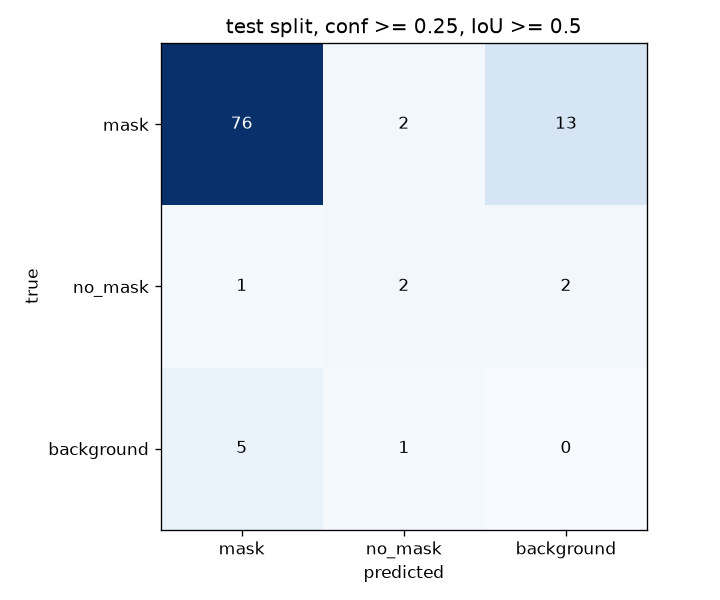

# Evaluate the Model and Find Its Mistakes

## Introduction

A single accuracy number hides the interesting part. This lab looks at your model class by class, at the kinds of errors it makes, and at the images where it fails, because that is where the next improvement comes from. It also teaches the discipline of reading numbers from a tiny test set with suspicion.

You evaluate on the **test** split. The model's checkpoint (`best.pt`) was chosen using the validation split, so validation scores are slightly optimistic. The test split was never used for any decision, which makes it the honest one, even though at 15 images it is small.

Estimated Time: 20 minutes

### Objectives

In this lab, you will:

* Compute precision, recall and mAP for each class
* Read a confusion matrix and an error analysis
* Find the images the model misses and gets wrong
* Measure how well a model's draft labels agree with human labels

### Prerequisites

This lab assumes you have:

* Completed Lab 3, with the trained model at `runs/ppe_v1/weights/best.pt`

## Task 1: Measure the model

`scripts/evaluate.py` runs the model on a split, prints the metrics per class, and then matches predictions with the ground-truth boxes to count the errors.

1. Run it on the test split. Replace `--device cpu` with `--device mps` or `--device 0` for a GPU.

    ```bash
    <copy>
    python scripts/evaluate.py --weights runs/ppe_v1/weights/best.pt --data datasets/ppe_mask/data.yaml --split test --device cpu --plot runs/confusion_matrix_test.png
    </copy>
    ```

2. Read the table. In the run used to write this lab, the test split gave:

    ```text
    class              P       R   mAP50  mAP50-95
    mask           0.948   0.809   0.934     0.584
    no_mask        1.000   0.376   0.650     0.338
    all            0.974   0.592   0.792     0.461
    ```

    The same model scored mAP50 0.843 and mAP50-95 0.522 on the validation split.

3. Know what each column means.

    * **Precision (P):** of the boxes the model drew, how many were right. Ultralytics reports it at the confidence threshold where each class's F1 score peaks, so it depends on a threshold you did not choose. `no_mask` shows 1.000 there, yet at the fixed threshold of 0.25 in Task 2 the model drew 5 `no_mask` boxes and only 2 were right.
    * **Recall (R):** of the real objects, how many the model found. `no_mask` has 0.376: it found about one in three of the people without a mask. For a safety check this is the number that hurts, because a missed violation is a silent failure.
    * **mAP50:** average precision when a box counts as correct if it overlaps the true box by at least 50 percent, averaged over classes.
    * **mAP50-95:** the same, averaged over stricter overlap thresholds from 50 to 95 percent. It rewards well-placed boxes and is always lower.

4. Treat the numbers with suspicion. The test split contains **5** `no_mask` boxes, so its recall of 0.376 is the result of finding 2 of 5. One more or one fewer found box moves it by 0.2. The validation split has 20 `no_mask` boxes and gave a recall of 0.600. The honest summary is "the model is clearly weaker on `no_mask` than on `mask`", not "recall is 0.376".

## Task 2: Read the confusion matrix and the error analysis

1. Look at the confusion matrix the script saved (`runs/confusion_matrix_test.png`). It uses a confidence threshold of 0.25 and an overlap of 0.5, and is the same table the script printed:

    ```text
    confusion matrix at conf>=0.25 (rows = truth, columns = prediction)
                        mask     no_mask  background
    mask                  76           2          13
    no_mask                1           2           2
    background             5           1           0
    ```

    

    Rows are the truth and columns the prediction. The `background` column counts real objects the model missed (13 masks and 2 people without a mask). The `background` row counts boxes the model drew where nothing exists, which are false alarms (5 masks and 1 `no_mask`). The off-diagonal cells inside the table are wrong-class boxes: 2 masked faces called `no_mask`, and 1 unmasked face called `mask`.

2. Read the summary line under the metrics.

    ```text
    error analysis at conf>=0.25, IoU>=0.5: {'gt': 96, 'tp': 78, 'fn': 15, 'fp': 6, 'wrong_class': 3}
    ```

    Of 96 true boxes the model got 78 right, missed 15 and labeled 3 with the wrong class, and it drew 6 boxes with nothing behind them. At this threshold, the dominant problem is **missed objects**, not wrong classes. That tells you what to fix: more and harder training examples, higher resolution or a lower confidence threshold, rather than relabeling.

## Task 3: Look at the worst images

The script lists the images with the most errors of each kind.

1. Read the lists under the summary line. In this run one image alone accounted for 6 of the 15 missed boxes, and a single image caused two of the three wrong-class boxes. A few images usually explain most of the errors.

2. Draw the model's boxes on the test images and look at them.

    ```bash
    <copy>
    python scripts/infer.py --weights runs/ppe_v1/weights/best.pt --source datasets/ppe_mask/test/images --save runs/annotated --conf 0.25
    </copy>
    ```

    The annotated copies are saved to `runs/annotated` under the file names the script listed. Open the ones from your worst-image list. Look for patterns before you change anything: small or blurred faces, faces turned away, masks that are the same colour as the skin, crowds, or boxes the annotator never drew. Missing labels in the ground truth show up here as "false alarms" that are actually correct.

## Task 4: Measure how well the model drafts labels

In Lab 2 you saw that a model can pre-label new photos for you to correct. Now you can measure how good the draft is, using the test images as stand-ins for photos nobody has labeled yet. `prelabel.py` writes draft labels, sorts every box into a confidence band, and with `--truth` compares the draft with the human labels.

1. Draft labels for the test images and compare them with the human labels.

    ```bash
    <copy>
    python scripts/prelabel.py --weights runs/ppe_v1/weights/best.pt --images datasets/ppe_mask/test/images --out prelabeled --accept 0.7 --review 0.25 --truth datasets/ppe_mask/test/labels
    </copy>
    ```

2. Read the result. In the run used to write this lab:

    ```text
    15 images pre-labelled -> prelabeled; boxes by band: {'review': 42, 'auto': 45}; images needing human review: 9
    agreement with human labels (same class, IoU >= 0.5):
      auto      45 drafted boxes,   44 correct (98 %)
      review    42 drafted boxes,   35 correct (83 %)
      human boxes found by the draft: 78 of 96 (81 %)
    ```

3. Draw the conclusion that matters. The confident boxes (`auto`) were right 98 percent of the time, so spot-checking them is enough. The uncertain boxes (`review`) were right 83 percent of the time, so a human must look at each of them. But the draft found only **78 of 96** human boxes: the 18 it missed carry no confidence and appear in no band. A reviewer who only inspects the `review` list will never see them. Pre-labeling saves time on boxes that exist, and a person still has to check every image for boxes that are not there.

## Task 5: Decide what to try next

Pick one change at a time and compare it with this baseline using the same test split and the same command. Candidates for this model, in the order that the errors above suggest:

* **More `no_mask` examples.** Add photos of people without masks, label them with the rules from Lab 2, and run `check_labels.py`. This addresses the rare class directly.
* **Higher resolution.** Train with `imgsz=960` if the missed faces are small.
* **A bigger model.** Replace `yolo26n.pt` with `yolo26s.pt`. It costs training time and inference speed.
* **A different confidence threshold.** For a safety check you may accept more false alarms to miss fewer violations. Lowering `--conf` in `infer.py` trades precision for recall.

Write each result in a table of your own, with the split sizes. Without that, it is easy to chase differences that are just noise.

You now know how to read the per-class numbers, what the errors are, and how much to trust all of it.

You may now **proceed to the next lab**.

## Learn More

* [Ultralytics performance metrics guide](https://docs.ultralytics.com/guides/yolo-performance-metrics/)
* [Ultralytics validation mode](https://docs.ultralytics.com/modes/val/)

## Acknowledgements

* **Author** - Ignacio Martinez, Oracle
* **Last Updated By/Date** - Ignacio Martinez, October 2026
