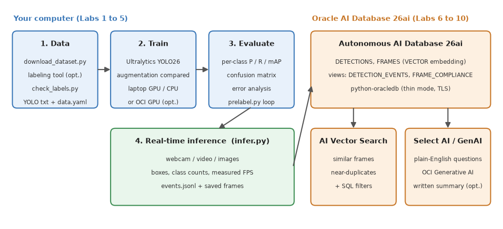

# Introduction

## About this Workshop

A camera is only useful if something understands what it sees. In this workshop you build that something end to end: a real-time **object detector** that finds people who are wearing a face mask and people who are not, which is the same pattern behind personal protective equipment (PPE) and safety-compliance checks such as hard hats and hi-vis vests. You then store what the detector sees in **Oracle AI Database 26ai**, ask questions about it in plain English with **Select AI**, and find similar frames with **AI Vector Search**.

This workshop replaces two earlier workshops, *Data Labeling with RoboFlow* and *Augmenting Data, Training and Real-Time Inference with YOLOv5*, and merges them into one path. What changed:

* **YOLO26 instead of YOLOv5.** You use the Ultralytics Python package (`pip install ultralytics`) and its `yolo` command. There are no repositories to clone and no `train.py` to patch.
* **A dataset that needs no login.** A small public mask dataset is downloaded by a script and converted to YOLO format for you, with the class order checked.
* **Labeling you can choose and check.** You pick a labeling tool (RoboFlow free tier or Label Studio), let a model pre-label new images, and run a script that catches the label mistakes that silently ruin a model.
* **Augmentation that is measured.** You train with and without augmentation and compare the numbers, instead of taking the effect on trust.
* **A real inference script.** Webcam, video file or image folder, correct colours, and a frame rate that is actually measured.
* **An Oracle AI Database 26ai half.** Detection events, natural-language analytics and similarity search.

> **Note:** OCI Data Labeling, which the old workshop mentioned as an alternative, reached end of life on August 30, 2025 and is no longer offered. This workshop uses Label Studio, an open-source tool that Oracle recommends as its replacement.

### What you build

1. **Data:** download and convert the dataset, then check the labels (Labs 1 and 2).
2. **Model:** fine-tune YOLO26 on your laptop, measure augmentation, evaluate the result (Labs 3 and 4).
3. **Inference:** run the model on a webcam, a video or images and write detection events (Lab 5).
4. **Database:** store events and frame embeddings, search by similarity, ask questions with Select AI, and optionally have a generative AI model write a summary (Labs 6 to 10).

### Be realistic about the data

The ready-made dataset has 149 photos. That is small on purpose: it trains on a laptop in minutes, so everyone finishes. It also means the numbers you get are noisy, and a class with few examples (people without a mask have only 5 boxes in the test split) can not be measured reliably. Part of the workshop is learning to see that.

Estimated Workshop Time: 4 hours (3 hours 10 minutes for Labs 1 to 8, 40 minutes for the optional Labs 9 and 10, and 10 minutes for Clean Up). Training time assumes a laptop with a GPU (Apple silicon or NVIDIA); on a CPU only, reduce the epochs as described in Lab 3.

### Objectives

By the end of this workshop you will have a trained object detector and a database that understands its output. You will:

* Set up a Python environment and get the dataset without any login (Lab 1)
* Choose a labeling tool, pre-label with a model and check label quality with a script (Lab 2)
* Fine-tune YOLO26 and measure what augmentation is worth (Lab 3)
* Evaluate the model per class and find the images it gets wrong (Lab 4)
* Run real-time detection on a webcam, video or images (Lab 5)
* Provision an Autonomous AI Database 26ai and store detection events in it (Labs 6 and 7)
* Search frames by similarity with AI Vector Search (Lab 8)
* Ask the database questions in plain English with Select AI (Lab 9, optional)
* Generate a written summary with OCI Generative AI (Lab 10, optional)

### Prerequisites

This workshop assumes you have:

* An Oracle Cloud tenancy where you can create an Autonomous AI Database, or a LiveLabs reservation that includes one (needed from Lab 6 on; Labs 1 to 5 run entirely on your computer)
* A macOS or Linux computer with Python 3.12 and Git. On Windows, use WSL 2 and follow the Linux commands
* About 3 GB of free disk space and a connection to the internet
* Basic familiarity with a command line and with Python

A webcam is optional: Lab 5 also works with a video file or images.

## Learn More

* [Ultralytics YOLO documentation](https://docs.ultralytics.com/)
* [Autonomous AI Database documentation](https://docs.oracle.com/en/cloud/paas/autonomous-database/)
* [Oracle AI Vector Search](https://docs.oracle.com/en/database/oracle/oracle-database/26/vecse/)
* [Select AI](https://docs.oracle.com/en/cloud/paas/autonomous-database/serverless/adbsb/sql-generation-ai-autonomous.html)

## Acknowledgements

* **Author** - Ignacio Martinez, Oracle
* **Last Updated By/Date** - Ignacio Martinez, October 2026
* **Dataset** - mask-wearing from the [Roboflow-100 benchmark](https://universe.roboflow.com/object-detection/mask-wearing-608pr), mirrored on Hugging Face by Francesco Zuppichini, licence CC BY 4.0
