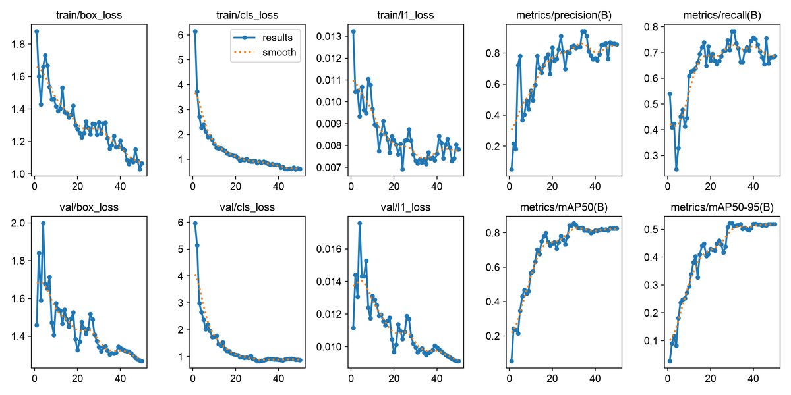
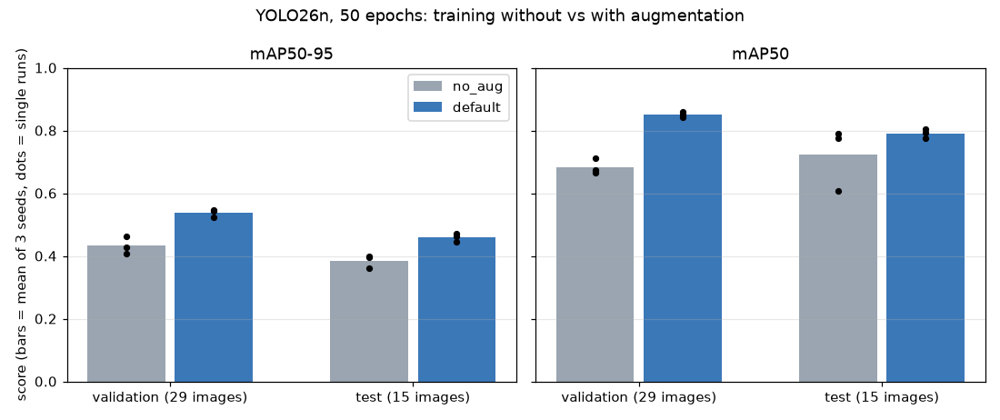

# Train YOLO26 and Measure Augmentation

## Introduction

Training teaches the pretrained model your two classes. You start from `yolo26n.pt`, the smallest YOLO26 model, which already knows how to find edges, shapes and everyday objects from the COCO dataset. Fine-tuning on 105 mask photos adapts it in minutes, not days. This is called *transfer learning*.

In this lab you first run a one-minute smoke test to prove that training works on your machine. Then you train a real model, and you measure the effect of **data augmentation** instead of taking it on trust. Augmentation shows the model altered copies of each training image (flipped, shifted, scaled, recoloured, mixed into mosaics) so that it generalises better from few images. It sounds always useful, so the lab asks: how much does it help here?

Estimated Time: 50 minutes (a one-minute smoke test, about 7 minutes for the main training run on an Apple M3 Pro GPU, and 40 to 60 minutes for the augmentation experiment)

### Objectives

In this lab, you will:

* Run a quick smoke test that works on any machine
* Fine-tune YOLO26 on the dataset and read the training output
* Compare training with and without augmentation over several seeds
* Know how to move the same training to an OCI GPU

### Prerequisites

This lab assumes you have:

* Completed Lab 1 (and, if you changed the dataset, Lab 2)
* A terminal in `workshops/yolo26_object_detection_26ai` with the environment active

## Task 1: Run a smoke test

A smoke test is a tiny run whose only job is to fail early. It trains for one epoch (one pass over the training images) at a low resolution on the CPU, which works on any machine.

1. Train for one epoch.

    ```bash
    <copy>
    yolo detect train model=yolo26n.pt data=$PWD/datasets/ppe_mask/data.yaml epochs=1 imgsz=320 batch=16 device=cpu workers=2 project=$PWD/runs name=smoke exist_ok=True
    </copy>
    ```

2. Wait for the run to finish. It takes well under a minute on a recent laptop. At the end you should see a validation table with the two classes and `Results saved to .../runs/smoke`. After one epoch the scores are close to zero (in the run used to write this lab, mAP50 was 0.015). That is expected: the point is that every stage ran.

> **Note:** Always give `project=` an **absolute** path such as `$PWD/runs`. With a relative path, Ultralytics silently nests the results under `runs/detect/`, and the commands in the next labs would not find your model.

## Task 2: Train the model

1. Choose the device for your machine and train for 50 epochs at 640 pixels. The command is the same everywhere except `device=`.

    * `device=mps` for an Apple silicon Mac
    * `device=0` for an NVIDIA GPU
    * `device=cpu` if you have neither. Use `epochs=20 imgsz=416` so the run finishes in a reasonable time

    ```bash
    <copy>
    yolo detect train model=yolo26n.pt data=$PWD/datasets/ppe_mask/data.yaml epochs=50 imgsz=640 batch=16 device=mps seed=0 workers=2 project=$PWD/runs name=ppe_v1
    </copy>
    ```

2. Watch the training table. Each epoch shows the losses (how wrong the model is on the training images; they should fall) and, after each epoch, the validation precision, recall and mAP. In the run used to write this lab, 50 epochs took about 6 minutes and 27 seconds on an Apple M3 Pro with `device=mps`, while other programs were using the machine, so expect a similar order of magnitude and not an exact time.

3. Read the final table. The best checkpoint was epoch 30, and on the 29 validation images it scored:

    ```text
    Class     Images  Instances      Box(P          R      mAP50  mAP50-95)
    all           29        162      0.838       0.71      0.843      0.522
    mask          28        142      0.841       0.82      0.912      0.597
    no_mask        9         20      0.836        0.6      0.774      0.448
    ```

    `mask` scores better than `no_mask`, as you would expect from five times more examples. Lab 4 explains each column and tests the model on images it has never seen.

4. Look at what training saved in `runs/ppe_v1`.

    * `weights/best.pt`: the checkpoint with the best validation score, which you use from now on
    * `weights/last.pt`: the final epoch, used to resume an interrupted run
    * `results.csv` and `results.png`: the numbers behind the curves below
    * `confusion_matrix.png`, `BoxPR_curve.png` and other plots

    

    The losses keep falling to the last epoch, but the validation mAP stopped improving around epoch 30. Past that point the model fits the training images more closely without getting better on new ones, which is what a plateau looks like on a small dataset. Ultralytics stops early if there is no improvement for 100 epochs (`patience=100`), which never triggers in a run this short.

> **Note:** Training is not exactly repeatable across machines and devices, even with `seed=0`. If your numbers differ by a few points from the ones shown, that is normal on a dataset this small.

## Task 3: Measure what augmentation is worth

Ultralytics applies a standard set of augmentations by default: mosaic (four images stitched into one), random scale and shift, left-right flips, and changes of hue, saturation and brightness. `scripts/train_compare.py` trains the same model twice per seed, with exactly the same settings except that one run switches **all** of those off (`no_aug`) and the other keeps the defaults (`default`). It then evaluates each `best.pt` on the validation split and on the held-out test split.

Several seeds matter because a single run on 29 validation images is noisy. The spread between seeds tells you how big a difference has to be before you believe it.

1. Run the comparison with three seeds. This trains six models, each as long as in Task 2, so it takes the better part of an hour on a laptop GPU. Start it and continue reading.

    ```bash
    <copy>
    python scripts/train_compare.py --data datasets/ppe_mask/data.yaml --epochs 50 --seeds 0 1 2 --device mps
    </copy>
    ```

    Use `--device 0` or `--device cpu` for other machines, and `--seeds 0` for a quicker, noisier answer.

2. At the end the script prints a table with the mean and the standard deviation over the seeds, and saves every run to `runs/aug_compare/summary.csv`.

3. Read the table. The values below come from the run used to write this lab: three seeds per preset, 50 epochs, 640 pixels, `device=mps`, mean ± standard deviation over the seeds.

    | preset | val mAP50 | val mAP50-95 | test mAP50 | test mAP50-95 | minutes/run |
    | --- | --- | --- | --- | --- | --- |
    | no_aug | 0.684 ± 0.024 | 0.433 ± 0.028 | 0.724 ± 0.100 | 0.385 ± 0.021 | 6.3 |
    | default | 0.851 ± 0.008 | 0.537 ± 0.013 | 0.791 ± 0.016 | 0.459 ± 0.013 | 6.6 |

    

4. Interpret it, with the sizes in mind.

    * **Augmentation clearly helped.** On the validation images, mAP50-95 rose from 0.433 to 0.537 and mAP50 from 0.684 to 0.851. The difference is several times larger than the spread between seeds, and the three `default` runs beat all three `no_aug` runs on both metrics.
    * **The test split agrees on the direction.** mAP50-95 went from 0.385 to 0.459. The test mAP50 of `no_aug` varied from 0.609 to 0.789 between seeds (a standard deviation of 0.100), so on 15 images only the mAP50-95 gap is convincing.
    * **Augmentation did not cost training time.** The runs took about the same, roughly 6 minutes each. It is applied to the images as they are loaded.
    * **What this does not tell you.** The `no_aug` preset switches off everything at once, so you do not know which augmentation did the work. To find out, copy the `no_aug` preset in `scripts/train_compare.py`, switch one setting back on at a time (for example `fliplr=0.5`, or `mosaic=1.0`), and compare again with the same seeds. The result also applies only to this tiny dataset and a nano model. Repeat the experiment before you assume it holds for your own data.

    Your numbers will differ somewhat, because training is not exactly repeatable across machines. The pattern should hold.


## Task 4: Scale up on OCI (optional)

Everything above fits on a laptop. If you want a bigger model (`yolo26s.pt` or `yolo26m.pt`), a larger image size, or much more data, a GPU in the cloud finishes the same job faster. The commands do not change: you only choose `device=0`. Two ways to get a GPU on OCI are described below. You do not need either to continue the workshop.

**A GPU virtual machine.**

1. In the Console, create a **Compute** instance with a GPU shape such as `VM.GPU.A10.1`. GPU shapes are limited by region and by your service limits, so check which ones your tenancy can use under **Governance**, **Limits, Quotas and Usage**.

2. Select an **Oracle Linux GPU** image, which includes the NVIDIA driver. Put the instance in a public subnet, or use a bastion if your network policy requires one, and add your SSH public key.

3. Connect with the **private** key (`-i` takes the private key, not the `.pub` file) and the default user `opc`, then check that the GPU is visible.

    ```bash
    ssh -i ~/.ssh/<your private key> opc@<public IP>
    nvidia-smi
    ```

4. On the instance, repeat Lab 1, Tasks 1 to 4. If Python 3.12 is not available from the system packages, the `uv` tool installs it for you with `uv venv --python 3.12`. Then run the Task 2 command with `device=0`.

5. Copy the model back to your computer, from your computer's terminal.

    ```bash
    scp -i ~/.ssh/<your private key> opc@<public IP>:ai-solutions/workshops/yolo26_object_detection_26ai/runs/ppe_v1/weights/best.pt .
    ```

6. **Terminate the instance when you finish.** A GPU machine bills for every hour it exists, running or not busy.

**An OCI Data Science notebook session.** Create a notebook session with a GPU shape, open its terminal, and run the same commands from Lab 1 and the `device=0` command from Task 2. The session keeps your files on its block volume and you pay while it is active, so deactivate or delete it afterwards.

You now have a trained model, you know how long training takes on your machine, and you have a measurement of what augmentation contributes.

You may now **proceed to the next lab**.

## Learn More

* [Ultralytics train mode](https://docs.ultralytics.com/modes/train/)
* [Ultralytics data augmentation guide](https://docs.ultralytics.com/guides/yolo-data-augmentation/)
* [OCI GPU compute shapes](https://docs.oracle.com/en-us/iaas/Content/Compute/References/computeshapes.htm)
* [OCI Data Science notebook sessions](https://docs.oracle.com/en-us/iaas/data-science/using/manage-notebook-sessions.htm)

## Acknowledgements

* **Author** - Ignacio Martinez, Oracle
* **Last Updated By/Date** - Ignacio Martinez, October 2026
